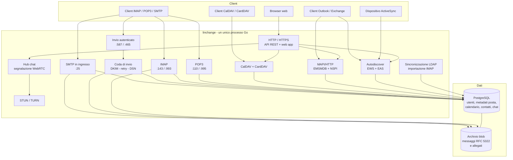
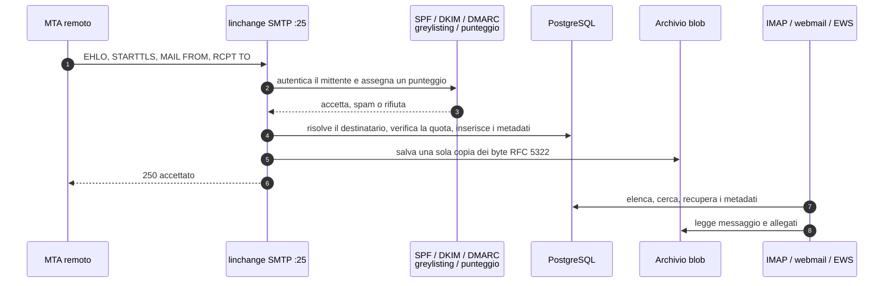

# linchange

**Posta e groupware self-hosted, in un unico processo.**

[English](README.md) | [Italiano](README.it.md)

linchange è un server di posta self-hosted con webmail, calendario, contatti,
riunioni, chat e compatibilità nativa con Microsoft Exchange/Outlook. È un solo
binario Go più PostgreSQL; i byte dei messaggi e gli allegati vivono in un
archivio blob content-addressed su disco. Non c'è nessun servizio separato per
chat, riunioni o rubriche da installare: tutto è nello stesso server.

> **Stato:** sviluppo attivo. Mantieni backup regolari e prova gli aggiornamenti
> prima di mettere una nuova versione in produzione.

## Indice

- [Funzionalità](#funzionalità)
- [Architettura](#architettura)
- [Porte](#porte)
- [Installazione](#installazione)
- [Configurazione](#configurazione)
- [Primo avvio e DNS](#primo-avvio-e-dns)
- [Operazioni](#operazioni)
- [Sviluppo](#sviluppo)
- [Struttura del progetto](#struttura-del-progetto)
- [Licenza](#licenza)

## Funzionalità

### Posta

- **SMTP in ingresso** sulla porta 25 con STARTTLS quando è configurato un
  certificato.
- **Invio autenticato** su 587 (STARTTLS) e 465 (TLS implicito), con verifica
  dell'identità del mittente e limiti giornalieri per utente.
- **IMAP/IMAPS e POP3/POP3S**, caselle condivise, alias con più destinazioni,
  quote, flag, conversazioni, ricerca full-text e allegati.
- **Coda di invio** con concorrenza per dominio, retry, bounce differiti (DSN),
  supporto per uno smart host e firma DKIM.
- **Autenticazione e filtraggio in ingresso**: verifica SPF, DKIM e DMARC,
  greylisting, rate limiting per sorgente, punteggio spam con soglie Junk/Reject
  e rifiuto dei destinatari sconosciuti.
- **Importazione IMAP remota** per migrare una casella esistente.
- **Regole lato server**: condizioni su mittente, destinatari, oggetto, corpo,
  header, allegati, dimensione e dominio del mittente; azioni per spostare,
  marcare, inoltrare o scartare.

### Client web

- Applicazione Angular a pagina singola per **posta, calendario, contatti,
  riunioni, chat e amministrazione**.
- Vista per conversazioni, ricerca, bozze, firme, immagini inline, gestione degli
  allegati e avanzamento delle importazioni.
- Autenticazione a due fattori TOTP con codici di recupero, reimpostazione della
  password, gestione delle sessioni e impersonificazione da parte
  dell'amministratore di dominio con motivo registrato.
- Amministrazione di domini, utenti, alias, caselle condivise, workgroup,
  gruppi, quote, autorizzazioni di impersonificazione, coda di invio, registro
  di audit e importazioni.

### Calendario e riunioni

- **CalDAV** per i client di calendario, con calendari condivisi tramite un
  modello offerta/accettazione.
- Ricerca della disponibilità, import/export iCalendar, inviti iTIP e RSVP, e
  risposte in ingresso gestite via mail.
- **Riunioni** con inviti via email, pagine RSVP pubbliche, reinvio e
  annullamento, e una sala riunioni a tutto schermo con galleria in stile Teams
  e barra laterale della chat comprimibile. Un ospite entra dal link
  dell'invito senza account; fotocamera e microfono sono opzionali.
- **Chiamate WebRTC** nel browser: media peer-to-peer, griglia centrata su chi
  parla, condivisione dello schermo come flusso separato solo in visione,
  alzata di mano e gestione della parola per conferenze a senso unico e
  webinar.
- **STUN/TURN integrato** per impostazione predefinita, con credenziali TURN a
  breve scadenza e possibilità di usare un server ICE esterno.

### Contatti

- Rubrica personale, rubriche con nome e directory dell'organizzazione.
- Condivisione con persone o gruppi tramite un'offerta che il destinatario deve
  accettare; i livelli sola lettura e lettura/scrittura sono applicati su ogni
  percorso.
- **CardDAV** per telefoni e client desktop, più autocompletamento nella webmail
  e nel modulo riunioni che mostra da quale rubrica proviene ogni suggerimento.
- **Cartelle contatti di Outlook** tramite MAPI/HTTP, e risoluzione della
  directory dell'organizzazione tramite NSPI (GAL) ed EWS `ResolveNames`.
- Aggiunta automatica dei destinatari alla rubrica personale del mittente, con
  arricchimento del nome dalla posta ricevuta.

### Chat e presenza

- Chat nativa su WebSocket, salvata nello stesso database della posta: messaggi
  diretti, gruppi ad hoc, gruppi dell'organizzazione e sale riunioni.
- Cronologia, indicatori di digitazione e conferme di lettura.
- Allegati nelle sale, salvati nel blob store content-addressed e scaricabili
  solo dai membri della sala.
- Le sale riunioni usano lo stesso canale di segnalazione per offerte, risposte
  e candidati ICE WebRTC; non serve alcun servizio esterno di chat o
  segnalazione.
- La chat della riunione sta accanto alla griglia video, così la conversazione
  resta visibile durante la chiamata invece di aprire una pagina separata.

### Compatibilità Microsoft ed Exchange

- **Autodiscover** su `/autodiscover/autodiscover.xml`.
- **EWS** su `/ews/exchange.asmx` per posta, calendario e risoluzione dei nomi
  nella directory.
- **Exchange ActiveSync** su `/eas` per client mobili di posta e calendario.
- **MAPI/HTTP** su `/mapi` con gli endpoint della casella (`emsmdb`) e della
  rubrica (`nspi`), così Outlook può usare cartelle di posta e contatti native.

Note di compatibilità:

- ActiveSync copre attualmente posta e calendario; i contatti sono serviti da
  CardDAV e MAPI.
- EWS espone posta, calendario e risoluzione dei nomi; non modella una cartella
  contatti separata.
- I gruppi di contatti di Outlook (liste di distribuzione) e le foto dei
  contatti non sono ancora mappati sulle proprietà MAPI.

### Sicurezza e operazioni

- Password con Argon2id, token JWT di accesso a breve scadenza e sessioni di
  refresh.
- Secondo fattore TOTP con segreti cifrati a riposo e codici di recupero.
- Blocco degli accessi per singolo account e per indirizzo IP.
- Autenticazione LDAP/Active Directory e riconciliazione periodica della
  directory.
- Registro di audit, autorizzazioni di impersonificazione e obbligo di motivo.
- Certificati ACME (Let's Encrypt) o PEM statici.
- Chiavi private DKIM cifrate a riposo.
- Migrazioni dello schema PostgreSQL applicate all'avvio o dal wizard di setup.
- Pacchetto `.deb` (con builder basato su Docker) e immagine Docker multi-stage.

## Architettura

linchange è un unico processo Go. Ogni listener di protocollo, l'API HTTP,
l'applicazione web e i worker in background condividono una configurazione, un
database e un insieme di servizi. È una scelta deliberata: una casella, un
evento di calendario e una scheda contatto hanno una sola rappresentazione, per
cui una modifica fatta via IMAP, web client, CalDAV, CardDAV, EWS o Outlook è
subito visibile ovunque.



### Componenti

| Area | Pacchetto / directory | Responsabilità |
| --- | --- | --- |
| Posta in ingresso | `internal/inbound` | SMTP :25, SPF/DKIM/DMARC, greylisting, punteggio spam, consegna locale |
| Invio | `internal/smtpd` | SMTP autenticato :587/:465, identità del mittente, limiti giornalieri |
| Posta in uscita | `internal/delivery` | Coda, consegna MX/smart host, retry, DSN, firma DKIM |
| Accesso alla posta | `internal/imapd`, `internal/pop3d` | IMAP/POP3, flag, quote, caselle condivise |
| Modello posta | `internal/webmail`, `internal/mail` | Archivio messaggi, ricerca, lettura, regole, composizione |
| API HTTP | `internal/httpapi` | API REST, hosting della SPA, chat WebSocket, endpoint ICE |
| Calendario | `internal/calendar`, `internal/caldav` | Eventi, disponibilità, iTIP, CalDAV, condivisione |
| Riunioni | `internal/meetings` | Inviti, RSVP, sale riunioni, segnalazione WebRTC |
| Contatti | `internal/contacts`, `internal/carddav` | vCard, rubriche, condivisioni, CardDAV, autocompletamento |
| Compatibilità Exchange | `internal/mapihttp`, `internal/ews`, `internal/eas`, `internal/autodiscover` | Outlook, EWS, ActiveSync e Autodiscover |
| Chiamate | `internal/webrtc`, `internal/chat` | STUN/TURN, credenziali ICE, hub chat |
| Identità | `internal/auth`, `internal/ldap*`, `internal/store` | Password, token, TOTP, LDAP, principal |
| Storage | `internal/store`, `internal/blobstore`, `migrations` | Repository PostgreSQL, migrazioni, blob content-addressed |
| Client web | `web/` | Applicazione Angular |
| Packaging | `package-docker.sh`, `package.sh`, `Dockerfile`, `packaging/` | Pacchetto Debian e immagine container |

### Dati e coerenza

- **PostgreSQL è la fonte di verità** per account, domini, caselle, metadati
  delle cartelle, indici di ricerca, eventi di calendario, contatti,
  condivisioni, chat, riunioni, regole, quote e voci di audit.
- I **byte dei messaggi** sono salvati una sola volta in un archivio blob
  content-addressed e referenziati tramite SHA-256 dalla tabella `messages`.
  IMAP, POP3, webmail, EWS ed EAS leggono gli stessi byte.
- I **calendari sono iCalendar e i contatti sono vCard** sotto le proiezioni
  relazionali. La proiezione è derivata, non una seconda copia: CalDAV,
  CardDAV, la UI web e le superfici Exchange modificano lo stesso record.
- Le **migrazioni** sono incorporate nel binario e applicate da
  `internal/store`; la versione dello schema viene verificata all'avvio quando
  la migrazione automatica è disattivata.
- Il modello di deployment è **un solo processo linchange attivo per database**.
  PostgreSQL può essere un servizio gestito su un altro host; l'archivio blob e
  la cache TLS/ACME sono locali a quel processo.

### Flusso della posta in ingresso



## Porte

I valori predefiniti in `config/linchange.example.yaml`:

| Porta | Protocollo | Servizio | Note |
| --- | --- | --- | --- |
| `25` | TCP | SMTP in ingresso | Deve essere raggiungibile da Internet per la consegna MX |
| `587` | TCP | Invio autenticato | STARTTLS + AUTH |
| `465` | TCP | Invio autenticato (TLS implicito) | Richiede un certificato; impostare l'indirizzo vuoto per disabilitare |
| `143` | TCP | IMAP | STARTTLS quando è presente un certificato |
| `993` | TCP | IMAPS | Richiede un certificato; impostare l'indirizzo vuoto per disabilitare |
| `110` | TCP | POP3 | STARTTLS quando è presente un certificato |
| `995` | TCP | POP3S | Richiede un certificato; impostare l'indirizzo vuoto per disabilitare |
| `80` | TCP | ACME HTTP-01 | Solo quando `tls.acme.enabled` è true |
| `8080` | TCP | API HTTP + web app | Predefinita nativa; mettere un reverse proxy davanti per la 443 |
| `443` | TCP | HTTPS | Reverse proxy, oppure listener `https` configurato |
| `3478` | UDP + TCP | STUN/TURN | Relay integrato per le chiamate |
| `49152`-`49251` | UDP | Allocazioni relay TURN | Ogni porta dell'intervallo deve essere raggiungibile |

**Non** esporre PostgreSQL (`5432`) su Internet. Se usi la demo Docker, le porte
sull'host sono volutamente spostate (`5025`, `5587`, `5143`, ...); vedi
`docker-compose.yml`.

## Installazione

### Requisiti

- Un server Linux. Debian 13 o Ubuntu 24.04+ è il target consigliato per il
  pacchetto `.deb`; la gestione del servizio usa systemd.
- **PostgreSQL 14 o successivo** (gli esempi Docker usano la 18).
- Un hostname con record `A` che punta al server, un record `PTR` corrispondente
  e un record `MX` per ogni dominio di posta ospitato.
- TLS: un account Let's Encrypt raggiungibile sulla porta 80, oppure una coppia
  certificato/chiave.
- Porta TCP 25 in uscita e accesso DNS per la consegna della posta; molti
  provider bloccano la 25 in uscita per impostazione predefinita, quindi
  verificalo prima di andare in produzione.
- Solo per la compilazione dai sorgenti: **Go 1.27+** e **Node.js 22.22+**.

### Pacchetto Debian/Ubuntu (consigliato)

Compila il pacchetto su una macchina con Docker:

```bash
git clone https://github.com/tizbac/linchange.git
cd linchange
./package-docker.sh
```

Il builder scrive `dist/linchange_<versione>_<architettura>.deb`. Copialo sul
server (il glob sotto presuppone `amd64`; usa la tua architettura altrimenti), poi:

```bash
# 1. PostgreSQL e un database per linchange
sudo apt update
sudo apt install -y postgresql
sudo -u postgres psql <<'SQL'
CREATE ROLE linchange LOGIN PASSWORD 'sostituisci-con-una-password-forte';
CREATE DATABASE linchange OWNER linchange;
SQL

# 2. Installa il pacchetto
sudo apt install ./dist/linchange_*_amd64.deb

# 3. Configura il server (salta se il postinst ha già avviato il wizard)
sudo linchange setup --config /etc/linchange/linchange.yaml

# 4. Avvialo
sudo systemctl enable --now linchange
```

Il `postinst` del pacchetto offre lo stesso wizard quando viene eseguito da un
terminale. In un'installazione non presidiata stampa il comando da eseguire in
seguito. Il wizard chiede la connessione al database, hostname, IP pubblico,
dominio ospitato, protocolli, modalità TLS e il primo account amministratore;
applica lo schema del database e crea l'admin.

Se preferisci creare il primo amministratore separatamente:

```bash
sudo linchange create-admin \
  --config /etc/linchange/linchange.yaml \
  --email admin@example.com
```

Controlla il servizio e apri l'interfaccia web:

```bash
systemctl status linchange
curl http://127.0.0.1:8080/healthz   # o la porta HTTP scelta dal wizard
```

Il pacchetto installa:

| Percorso | Contenuto |
| --- | --- |
| `/usr/bin/linchange` | Binario del server, `setup` e `create-admin` |
| `/usr/share/linchange/web` | Applicazione web compilata |
| `/etc/linchange/linchange.example.yaml` | Configurazione di esempio completamente commentata |
| `/etc/linchange/linchange.yaml` | Configurazione generata (0600, non inclusa nel pacchetto) |
| `/var/lib/linchange` | Archivio blob, cache ACME e dati di runtime |
| `/var/log/linchange` | Directory dei log, quando il logging su file è abilitato |
| `/usr/lib/systemd/system/linchange.service` | Unità systemd |

### Demo Docker (valutazione)

Lo script di demo compila l'immagine, avvia PostgreSQL e un'istanza demo, e
stampa le credenziali:

```bash
./run-demo.sh
```

Pubblica porte non standard, così può convivere con un vero server di posta:

- Web: `http://localhost:58080`
- Admin: `admin@localhost` / `DemoAdmin123!` (solo demo)
- Porte host: `5025` SMTP, `5587` invio, `5143` IMAP, `5110` POP3,
  `58080` HTTP, `53478` TURN.

Non esporre la demo su Internet e non riutilizzare le sue credenziali.

### Docker (traccia per la produzione)

Il percorso container richiede un file di configurazione completo. Parti
dall'esempio orientato a Docker e inserisci i valori del deployment:

```bash
cp config/linchange.docker.yaml config/linchange.yaml
$EDITOR config/linchange.yaml
```

Imposta almeno:

- `server.hostname`, `server.public_ip` e `server.data_dir`
- `database.url` (il compose usa il nome del servizio `postgres`)
- `auth.jwt.secret`, `auth.encryption_key` e
  `mail.dkim_private_key_encryption_key`, collegati a `JWT_SECRET`,
  `AUTH_ENCRYPTION_KEY` e `DKIM_ENCRYPTION_KEY`
- la password del database tramite `DB_PASSWORD`

Le chiavi di cifratura sono obbligatorie perché TOTP e firma DKIM sono
abilitati per impostazione predefinita; il server rifiuta di partire senza. Poi:

```bash
export JWT_SECRET="$(openssl rand -base64 32)"
export DB_PASSWORD='sostituisci-con-una-password-forte'
export AUTH_ENCRYPTION_KEY="$(openssl rand -base64 32)"
export DKIM_ENCRYPTION_KEY="$(openssl rand -base64 32)"
docker compose --profile production up -d --build
```

Il compose mappa le porte standard del container sulle porte host spostate
elencate sopra. L'esempio serve HTTP sulla 8080 per un reverse proxy e lascia
disabilitati i listener solo TLS (HTTPS, 465, 993, 995) finché non viene
configurato un certificato. Termina TLS su un reverse proxy, oppure fornisci
`tls.cert_file`/`tls.key_file` (o ACME) e imposta i loro indirizzi a `:8443`,
`:465`, `:993` e `:995`. Il profilo di produzione è `linchange`;
`docker compose up -d` da solo avvia solo PostgreSQL.

### Compilazione dai sorgenti

```bash
git clone https://github.com/tizbac/linchange.git
cd linchange
make up             # PostgreSQL su 127.0.0.1:55432
make dev-config     # genera linchange.dev.yaml e .env
make all            # server + build web
set -a; . ./.env; set +a
./bin/linchange --config linchange.dev.yaml \
  --web-dir web/dist/linchange-web/browser
```

Per lo sviluppo del frontend, avvia l'API con `make dev` e il dev server
Angular separatamente:

```bash
cd web && npm start
```

Il dev server fa da proxy per `/api` verso `http://127.0.0.1:8080`. Vedi
`web/proxy.conf.json`.

## Configurazione

- Il server richiede `--config <percorso>`; non esistono default impliciti che
  accetterebbero posta per un dominio non configurato.
- `config/linchange.example.yaml` è il riferimento completo e commentato. Ogni
  valore è un default integrato, salvo diversa indicazione.
- `${VAR}` e `${VAR:-fallback}` vengono espansi dall'ambiente. Un riferimento
  senza valore e senza fallback è un errore all'avvio, così un segreto mancante
  fallisce subito.
- Il wizard scrive un file 0600 con i segreti generati. Tienilo fuori dal
  controllo di versione.
- Valida un file senza avviare il server:

```bash
linchange --config /etc/linchange/linchange.yaml --check-config
```

I segreti obbligatori sono `auth.jwt.secret`, `auth.encryption_key` (quando TOTP
è abilitato) e `mail.dkim_private_key_encryption_key` (quando la firma DKIM è
attiva). Cambiare `auth.jwt.secret` disconnette tutti; cambiare le chiavi di
cifratura rende illeggibili le iscrizioni TOTP esistenti e le chiavi DKIM
salvate.

## Primo avvio e DNS

1. Punta `mail.example.com` al server e assegna all'indirizzo pubblico un
   record PTR corrispondente. I server remoti rifiutano posta senza una coppia
   forward/reverse DNS coerente.
2. Pubblica un record MX per ogni dominio ospitato:

   ```dns
   example.com.        MX   10 mail.example.com.
   mail.example.com.   A    203.0.113.10
   10.113.0.203.in-addr.arpa. PTR mail.example.com.
   ```

3. Pubblica SPF e DMARC. Un punto di partenza rigoroso:

   ```dns
   example.com. TXT "v=spf1 mx -all"
   _dmarc.example.com. TXT "v=DMARC1; p=quarantine; rua=mailto:postmaster@example.com"
   ```

4. Aggiungi nel pannello di amministrazione la chiave pubblica DKIM per il
   selettore del dominio (Domini → selettore DKIM). Il server firma la posta in
   uscita con la chiave privata corrispondente.
5. Accedi con l'amministratore creato dal wizard, aggiungi domini e utenti, e
   apri `/admin` per le viste di gestione.

Se usi ACME, assicurati che la porta 80 sia raggiungibile e che l'hostname
risolva su questo server prima di avviare il servizio.

## Operazioni

### Backup

Esegui il backup sia del database sia della directory dati:

```bash
pg_dump -Fc linchange > linchange-$(date +%F).dump
sudo tar czf linchange-data-$(date +%F).tgz \
  /var/lib/linchange /etc/linchange/linchange.yaml
```

L'archivio blob contiene i byte dei messaggi e gli allegati; il solo database
non è un backup completo. Tieni privato il backup della configurazione: contiene
la password del database e le chiavi di cifratura.

### Aggiornamento

```bash
sudo apt install ./dist/linchange_<nuova-versione>_amd64.deb
```

Il pacchetto riavvia un servizio in esecuzione e applica le migrazioni del
database in sospeso quando `database.auto_migrate` è abilitato. Fai prima un
backup e leggi le note di rilascio per eventuali cambi di schema o
configurazione.

### Log e stato

```bash
journalctl -u linchange -f
curl http://127.0.0.1:8080/healthz
```

Il pannello di amministrazione espone anche la coda di invio e il registro di
audit.

## Sviluppo

```bash
make help                 # tutti i target
make test-unit            # test che non richiedono il database
make up                   # PostgreSQL per la suite di integrazione
make test                 # test unitari + integrazione
cd web && npm run e2e     # suite end-to-end Playwright
```

La suite end-to-end avvia uno stack proprio su `127.0.0.1:18080`, con un
database separato e porte non standard; vedi `web/e2e/stack.sh`.

## Struttura del progetto

```text
cmd/linchange/        entry point del server, wizard di setup, create-admin
config/               tipi di configurazione, validazione, esempi
internal/             package del server (protocolli, servizi, storage)
migrations/           migrazioni dello schema PostgreSQL
web/                  client web Angular e test Playwright
packaging/debian/     script maintainer condivisi dai due packager
docs/                 note su protocolli e funzionalità
Dockerfile            immagine runtime multi-stage
Dockerfile.build      immagine per il builder del pacchetto Debian
package-docker.sh     crea un .deb dentro Docker (consigliato)
package.sh            crea un .deb con i toolchain Go/Node locali
```

## Licenza

linchange è software libero: puoi ridistribuirlo e/o modificarlo secondo i
termini della GNU General Public License come pubblicata dalla Free Software
Foundation, versione 3 della licenza oppure (a tua scelta) una versione
successiva.

Vedi [LICENSE](LICENSE) per il testo completo.

Copyright (C) 2026 linchange contributors.
