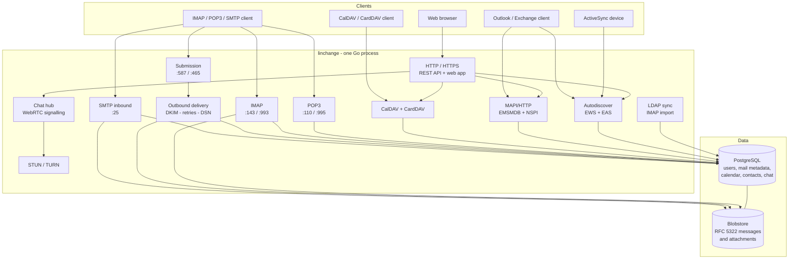
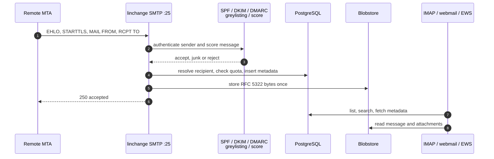

# linchange

**Self-hosted mail and groupware, in one process.**

[English](README.md) | [Italiano](README.it.md)

linchange is a self-hosted mail server with webmail, calendar, contacts,
meetings, chat and native Microsoft Exchange/Outlook compatibility. It is one
Go binary plus PostgreSQL; message bytes and attachments live in a
content-addressed blobstore on disk. There is no separate chat, meeting or
address-book service to install: everything ships in the same server.

> **Status:** active development. Keep backups and test upgrades before putting
> a new release into production.

## Contents

- [Features](#features)
- [Architecture](#architecture)
- [Ports](#ports)
- [Installation](#installation)
- [Configuration](#configuration)
- [First run and DNS](#first-run-and-dns)
- [Operations](#operations)
- [Development](#development)
- [Project layout](#project-layout)
- [License](#license)

## Features

### Mail

- **SMTP inbound** on port 25 with STARTTLS when a certificate is configured.
- **Authenticated submission** on 587 (STARTTLS) and 465 (implicit TLS), with
  sender-identity enforcement and per-user daily send limits.
- **IMAP/IMAPS and POP3/POP3S**, shared mailboxes, aliases with multiple
  targets, quotas, flags, threads, full-text search and attachments.
- **Outbound delivery queue** with per-domain concurrency, retries, delayed
  bounces (DSN), a smart-host option and DKIM signing.
- **Inbound authentication and filtering**: SPF, DKIM and DMARC verification,
  greylisting, per-source rate limiting, spam scoring with Junk/Reject
  thresholds and unknown-recipient rejection.
- **Remote IMAP import** for migrating an existing mailbox.
- **Server-side rules**: conditions on sender, recipients, subject, body,
  headers, attachments, size and sender domain; actions to move, mark, forward
  or discard.

### Web client

- Angular single-page application for **mail, calendar, contacts, meetings,
  chat and administration**.
- Conversation view, search, drafts, signatures, inline images, attachment
  handling and import progress.
- Two-factor authentication with TOTP and recovery codes, password reset,
  session management and domain-admin impersonation with a recorded reason.
- Administration for domains, users, aliases, shared mailboxes, workgroups,
  groups, quotas, impersonation grants, the outbound queue, the audit log and
  imports.

### Calendar and meetings

- **CalDAV** for calendar clients, with shared calendars using an
  offer/accept model.
- Free/busy lookup, iCalendar import/export, iTIP invitations and RSVP, and
  inbound replies processed by mail.
- **Meetings** with email invitations, public RSVP pages, resend/cancel, and a
  full-screen meeting room with a Teams-style gallery and a collapsible chat
  sidebar. A guest joins from the invitation link without an account; camera
  and microphone are optional.
- **WebRTC calls** in the browser: peer-to-peer media, a speaker-focused grid,
  screen sharing as a separate view-only feed, hand raising and
  presenter-controlled floor for one-way conferences and webinars.
- **Built-in STUN/TURN** by default, with short-lived TURN credentials and an
  option to point at an external ICE server instead.

### Contacts

- Personal address book, named books, and an organization directory.
- Sharing with people or groups through an offer the recipient must accept;
  read-only and read/write levels are enforced on every path.
- **CardDAV** for phones and desktop contact clients, plus web and composer
  autocomplete that shows which book each suggestion came from.
- **Outlook contact folders** through MAPI/HTTP, and organization-directory
  resolution through NSPI (GAL) and EWS `ResolveNames`.
- Automatic addition of recipients to the sender's personal book, with name
  backfill from received mail.

### Chat and presence

- Native chat over WebSocket, stored in the same database as mail: direct
  messages, ad-hoc groups, organization groups and meeting rooms.
- History, typing indicators and read receipts.
- Meeting rooms use the same signalling channel for WebRTC offers, answers and
  ICE candidates; no external chat or signalling service is involved.
- The meeting chat sits beside the video grid, so the conversation stays
  visible during the call instead of opening a separate page.

### Microsoft and Exchange compatibility

- **Autodiscover** at `/autodiscover/autodiscover.xml`.
- **EWS** at `/ews/exchange.asmx` for mail, calendar and directory name
  resolution.
- **Exchange ActiveSync** at `/eas` for mobile mail and calendar clients.
- **MAPI/HTTP** at `/mapi` with the mailbox (`emsmdb`) and address-book
  (`nspi`) endpoints, so Outlook can use native mail and contact folders.

Compatibility notes:

- ActiveSync currently covers mail and calendar; contacts are served by
  CardDAV and MAPI.
- EWS exposes mail, calendar and name resolution; it does not model a separate
  contacts folder.
- Outlook contact groups (distribution lists) and contact photos are not yet
  mapped to MAPI properties.

### Security and operations

- Argon2id password hashing, short-lived JWT access tokens and refresh sessions.
- TOTP second factor with encrypted secrets at rest and recovery codes.
- Per-account and per-IP login lockouts.
- LDAP/Active Directory authentication and periodic directory reconciliation.
- Audit logging, impersonation grants and a reason requirement.
- ACME (Let's Encrypt) or static PEM certificates.
- DKIM private keys encrypted at rest.
- PostgreSQL schema migrations applied at startup or by the setup wizard.
- Packaging as a `.deb` (Docker-based builder included) and a multi-stage
  Docker image.

## Architecture

linchange is a single Go process. Every protocol listener, the HTTP API, the
web application and the background workers share one configuration, one
database and one set of services. That is deliberate: a mailbox, a calendar
event and a contact card have one representation, so a change made through
IMAP, the web client, CalDAV, CardDAV, EWS or Outlook is visible everywhere
else immediately.



### Components

| Area | Package / directory | Responsibility |
| --- | --- | --- |
| Inbound mail | `internal/inbound` | SMTP :25, SPF/DKIM/DMARC, greylisting, spam score, local delivery |
| Submission | `internal/smtpd` | Authenticated SMTP :587/:465, sender identity, daily limits |
| Outbound mail | `internal/delivery` | Queue, MX/smart-host delivery, retries, DSN, DKIM signing |
| Mail access | `internal/imapd`, `internal/pop3d` | IMAP/POP3, flags, quotas, shared mailboxes |
| Mail model | `internal/webmail`, `internal/mail` | Message storage, search, reading, rules, composition |
| HTTP API | `internal/httpapi` | REST API, SPA host, WebSocket chat, ICE endpoint |
| Calendar | `internal/calendar`, `internal/caldav` | Events, free/busy, iTIP, CalDAV, sharing |
| Meetings | `internal/meetings` | Invitations, RSVP, meeting rooms, WebRTC signalling |
| Contacts | `internal/contacts`, `internal/carddav` | vCards, books, shares, CardDAV, autocomplete |
| Exchange compatibility | `internal/mapihttp`, `internal/ews`, `internal/eas`, `internal/autodiscover` | Outlook, EWS, ActiveSync and Autodiscover |
| Calls | `internal/webrtc`, `internal/chat` | STUN/TURN, ICE credentials, chat hub |
| Identity | `internal/auth`, `internal/ldap*`, `internal/store` | Passwords, tokens, TOTP, LDAP, principals |
| Storage | `internal/store`, `internal/blobstore`, `migrations` | PostgreSQL repositories, migrations, content-addressed blobs |
| Web client | `web/` | Angular application |
| Packaging | `package-docker.sh`, `package.sh`, `Dockerfile`, `packaging/` | Debian package and container image |

### Data and consistency

- **PostgreSQL is the source of truth** for accounts, domains, mailboxes,
  folder metadata, search indexes, calendar events, contacts, shares, chat,
  meetings, rules, quotas and audit entries.
- **Message bytes** are stored once in a content-addressed blobstore and
  referenced by SHA-256 from the `messages` table. IMAP, POP3, webmail, EWS and
  EAS all read the same bytes.
- **Calendars are iCalendar and contacts are vCard** underneath the relational
  projections. The projection is derived, not a second copy: CalDAV, CardDAV,
  the web UI and the Exchange surfaces edit the same record.
- **Migrations** are embedded in the binary and applied by `internal/store`;
  the schema version is checked on startup when auto-migration is disabled.
- The deployment model is **one active linchange process per database**.
  PostgreSQL may be a managed service on another host; the blobstore and the
  TLS/ACME cache are local to that process.

### Inbound mail flow



## Ports

The defaults in `config/linchange.example.yaml`:

| Port | Protocol | Service | Notes |
| --- | --- | --- | --- |
| `25` | TCP | SMTP inbound | Must be reachable from the internet for MX delivery |
| `587` | TCP | Submission | STARTTLS + AUTH |
| `465` | TCP | Submission (implicit TLS) | Requires a certificate; set the address empty to disable |
| `143` | TCP | IMAP | STARTTLS when a certificate is present |
| `993` | TCP | IMAPS | Requires a certificate; set the address empty to disable |
| `110` | TCP | POP3 | STARTTLS when a certificate is present |
| `995` | TCP | POP3S | Requires a certificate; set the address empty to disable |
| `80` | TCP | ACME HTTP-01 | Only when `tls.acme.enabled` is true |
| `8080` | TCP | HTTP API + web app | Native default; put a reverse proxy in front for 443 |
| `443` | TCP | HTTPS | Reverse proxy, or the `https` listener when configured |
| `3478` | UDP + TCP | STUN/TURN | Built-in calls relay |
| `49152`-`49251` | UDP | TURN relay allocations | Every port in the range must be reachable |

Do **not** expose PostgreSQL (`5432`) to the internet. If you use the Docker
demo, the host ports are deliberately shifted (`5025`, `5587`, `5143`, ...);
see `docker-compose.yml`.

## Installation

### Requirements

- A Linux server. Debian 13 or Ubuntu 24.04+ is the recommended target for the
  `.deb`; systemd is used for service management.
- **PostgreSQL 14 or newer** (18 is used in the Docker examples).
- A hostname with an `A` record pointing at the server, a matching `PTR`
  record, and an `MX` record for each hosted mail domain.
- TLS: a Let's Encrypt account reachable on port 80, or a certificate/key pair.
- Outbound TCP 25 and DNS access for outbound delivery; many hosting providers
  block outbound port 25 by default, so check that before going live.
- For building from source only: **Go 1.27+** and **Node.js 22.22+**.

### Debian/Ubuntu package (recommended)

Build the package on a machine with Docker:

```bash
git clone https://github.com/tizbac/linchange.git
cd linchange
./package-docker.sh
```

The builder writes `dist/linchange_<version>_<arch>.deb`. Copy it to the
server (the glob below assumes `amd64`; use your architecture otherwise), then:

```bash
# 1. PostgreSQL and a database for linchange
sudo apt update
sudo apt install -y postgresql
sudo -u postgres psql <<'SQL'
CREATE ROLE linchange LOGIN PASSWORD 'replace-with-a-strong-password';
CREATE DATABASE linchange OWNER linchange;
SQL

# 2. Install the package
sudo apt install ./dist/linchange_*_amd64.deb

# 3. Configure the server (skip if postinst already ran the wizard)
sudo linchange setup --config /etc/linchange/linchange.yaml

# 4. Start it
sudo systemctl enable --now linchange
```

The package's `postinst` offers the same wizard when it is run from a
terminal. In an unattended install it prints the command to run later. The
wizard asks for the database connection, hostname, public IP, hosted domain,
protocols, TLS mode and the first administrator account; it applies the
database schema and creates the admin.

If you prefer to create the first administrator separately:

```bash
sudo linchange create-admin \
  --config /etc/linchange/linchange.yaml \
  --email admin@example.com
```

Check the service and open the web interface:

```bash
systemctl status linchange
curl http://127.0.0.1:8080/healthz   # or the HTTP port chosen by the wizard
```

The package installs:

| Path | Contents |
| --- | --- |
| `/usr/bin/linchange` | Server binary, `setup` and `create-admin` |
| `/usr/share/linchange/web` | Built web application |
| `/etc/linchange/linchange.example.yaml` | Fully commented example configuration |
| `/etc/linchange/linchange.yaml` | Generated configuration (0600, not shipped) |
| `/var/lib/linchange` | Blobstore, ACME cache and runtime data |
| `/var/log/linchange` | Log directory, when file logging is enabled |
| `/usr/lib/systemd/system/linchange.service` | systemd unit |

### Docker demo (evaluation)

The demo script builds the image, starts PostgreSQL and a demo instance, and
prints the credentials:

```bash
./run-demo.sh
```

It publishes non-standard host ports so it can run beside a real mail server:

- Web: `http://localhost:58080`
- Admin: `admin@localhost` / `DemoAdmin123!` (demo only)
- Host ports: `5025` SMTP, `5587` submission, `5143` IMAP, `5110` POP3,
  `58080` HTTP, `53478` TURN.

Do not expose the demo to the internet or reuse its credentials.

### Docker (production outline)

The container path needs a complete configuration file. Start from the
Docker-oriented example and fill in the deployment values:

```bash
cp config/linchange.docker.yaml config/linchange.yaml
$EDITOR config/linchange.yaml
```

At minimum set:

- `server.hostname`, `server.public_ip` and `server.data_dir`
- `database.url` (the compose file uses the `postgres` service name)
- `auth.jwt.secret`, `auth.encryption_key` and
  `mail.dkim_private_key_encryption_key`, wired to `JWT_SECRET`,
  `AUTH_ENCRYPTION_KEY` and `DKIM_ENCRYPTION_KEY`
- the database password via `DB_PASSWORD`

The encryption keys are required because TOTP and DKIM signing are enabled by
default; the server refuses to start without them. Then:

```bash
export JWT_SECRET="$(openssl rand -base64 32)"
export DB_PASSWORD='replace-with-a-strong-password'
export AUTH_ENCRYPTION_KEY="$(openssl rand -base64 32)"
export DKIM_ENCRYPTION_KEY="$(openssl rand -base64 32)"
docker compose --profile production up -d --build
```

The compose file maps standard container ports to the shifted host ports listed
above. The sample serves HTTP on 8080 for a reverse proxy and leaves the
TLS-only listeners (HTTPS, 465, 993, 995) disabled until a certificate is
configured. Terminate TLS at a reverse proxy, or provide
`tls.cert_file`/`tls.key_file` (or ACME) and set their addresses to `:8443`,
`:465`, `:993` and `:995`. The production profile is `linchange`;
`docker compose up -d` alone starts only PostgreSQL.

### Build from source

```bash
git clone https://github.com/tizbac/linchange.git
cd linchange
make up             # PostgreSQL on 127.0.0.1:55432
make dev-config     # generates linchange.dev.yaml and .env
make all            # server + web build
set -a; . ./.env; set +a
./bin/linchange --config linchange.dev.yaml \
  --web-dir web/dist/linchange-web/browser
```

For frontend development, run the API with `make dev` and the Angular dev
server separately:

```bash
cd web && npm start
```

The dev server proxies `/api` to `http://127.0.0.1:8080`. See
`web/proxy.conf.json`.

## Configuration

- The server requires `--config <path>`; there are no implicit defaults that
  would accept mail for an unconfigured domain.
- `config/linchange.example.yaml` is the complete, commented reference. Every
  value in it is a built-in default unless stated otherwise.
- `${VAR}` and `${VAR:-fallback}` are expanded from the environment. A
  reference with no value and no fallback is a startup error, so a missing
  secret fails immediately.
- The wizard writes a 0600 file with generated secrets. Keep it out of version
  control.
- Validate a file without starting the server:

```bash
linchange --config /etc/linchange/linchange.yaml --check-config
```

Required secrets are `auth.jwt.secret`, `auth.encryption_key` (when TOTP is
enabled) and `mail.dkim_private_key_encryption_key` (when DKIM signing is on).
Changing `auth.jwt.secret` signs everyone out; changing the encryption keys
makes existing TOTP enrolments and stored DKIM keys unreadable.

## First run and DNS

1. Point `mail.example.com` at the server and give the public address a
   matching PTR record. Outbound receivers reject mail without a matching
   forward and reverse DNS pair.
2. Publish an MX record for every hosted domain:

   ```dns
   example.com.        MX   10 mail.example.com.
   mail.example.com.   A    203.0.113.10
   10.113.0.203.in-addr.arpa. PTR mail.example.com.
   ```

3. Publish SPF and DMARC. A strict starting point:

   ```dns
   example.com. TXT "v=spf1 mx -all"
   _dmarc.example.com. TXT "v=DMARC1; p=quarantine; rua=mailto:postmaster@example.com"
   ```

4. Add the DKIM public key for the domain's selector in the admin panel
   (Domains → DKIM selector). The server signs outbound mail with the matching
   private key.
5. Sign in with the administrator created by the wizard, add domains and users,
   and open `/admin` for the management views.

If you use ACME, make sure port 80 is reachable and the hostname resolves to
this server before starting the service.

## Operations

### Backup

Back up both the database and the data directory:

```bash
pg_dump -Fc linchange > linchange-$(date +%F).dump
sudo tar czf linchange-data-$(date +%F).tgz \
  /var/lib/linchange /etc/linchange/linchange.yaml
```

The blobstore contains the message bytes and attachments; the database alone
is not a complete backup. Keep the configuration backup private: it contains
the database password and the encryption keys.

### Upgrade

```bash
sudo apt install ./dist/linchange_<new-version>_amd64.deb
```

The package restarts a running service and applies pending database migrations
when `database.auto_migrate` is enabled. Back up first, and read the release
notes for schema or configuration changes.

### Logs and health

```bash
journalctl -u linchange -f
curl http://127.0.0.1:8080/healthz
```

The admin panel also exposes the outbound queue and the audit log.

## Development

```bash
make help                 # all targets
make test-unit            # tests that need no database
make up                   # PostgreSQL for the integration suite
make test                 # unit + integration tests
cd web && npm run e2e     # Playwright end-to-end suite
```

The end-to-end suite starts its own stack on `127.0.0.1:18080` with a separate
database and non-standard ports; see `web/e2e/stack.sh`.

## Project layout

```text
cmd/linchange/        server entry point, setup wizard, create-admin
config/               configuration types, validation, examples
internal/             server packages (protocols, services, storage)
migrations/           PostgreSQL schema migrations
web/                  Angular web client and Playwright tests
packaging/debian/     maintainer scripts shared by both packagers
docs/                 protocol and feature notes
Dockerfile            multi-stage runtime image
Dockerfile.build      Debian package builder image
package-docker.sh     build a .deb inside Docker (recommended)
package.sh            build a .deb with local Go/Node toolchains
```

## License

linchange is free software: you can redistribute it and/or modify it under the
terms of the GNU General Public License as published by the Free Software
Foundation, either version 3 of the License, or (at your option) any later
version.

See [LICENSE](LICENSE) for the full text.

Copyright (C) 2026 linchange contributors.
